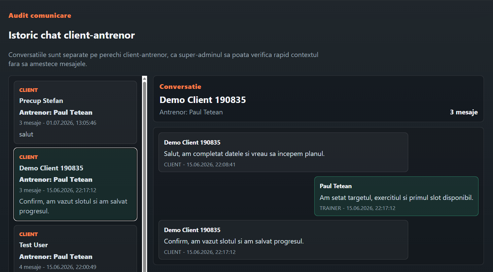
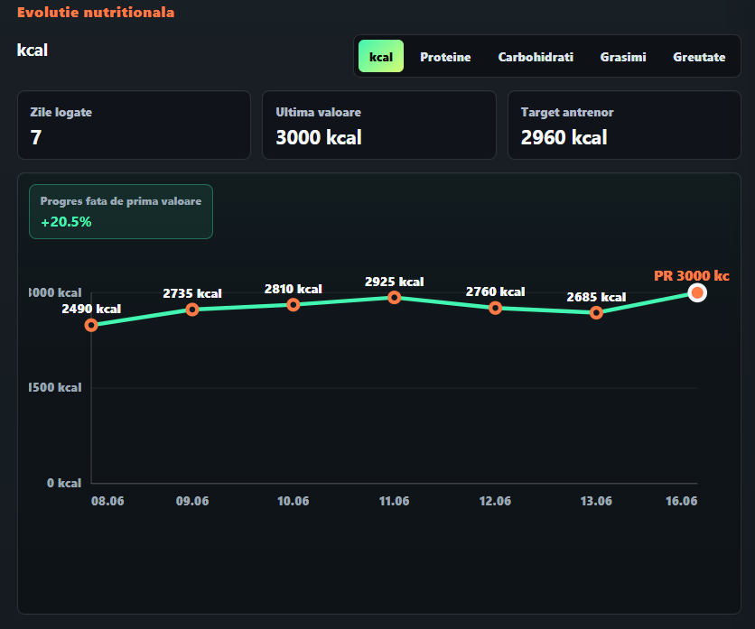
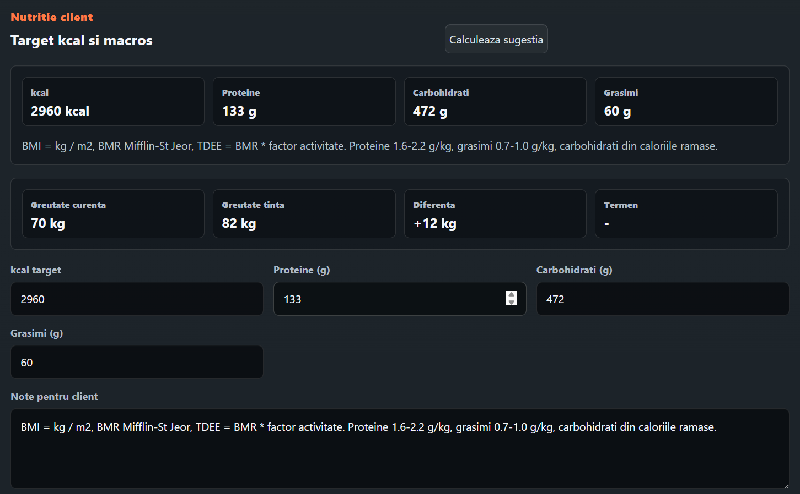
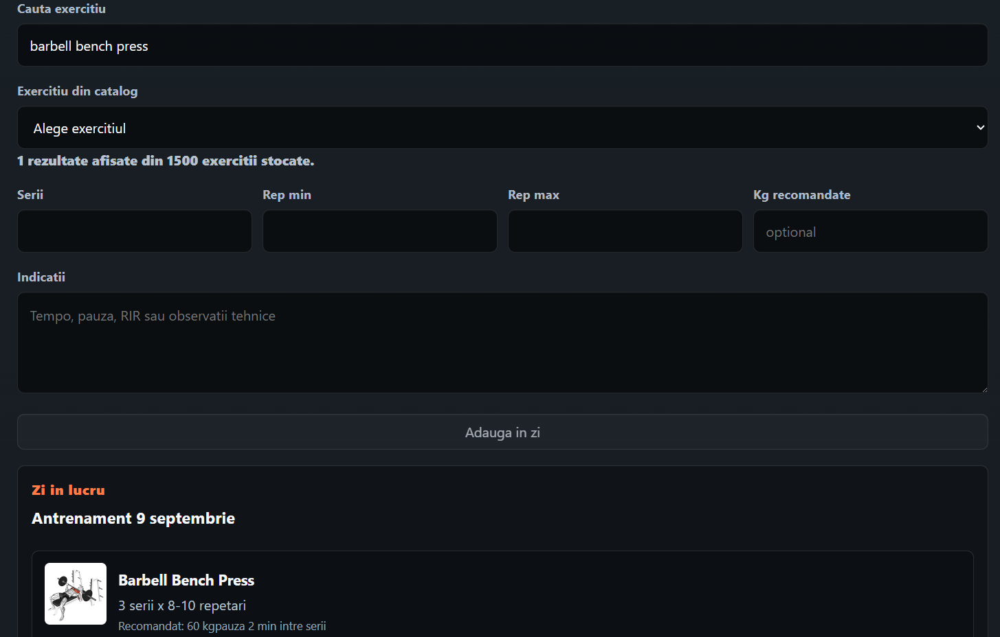
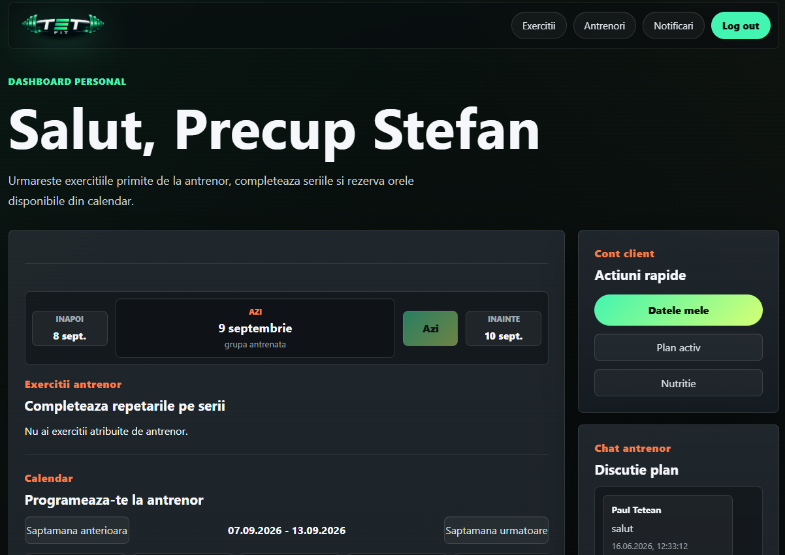
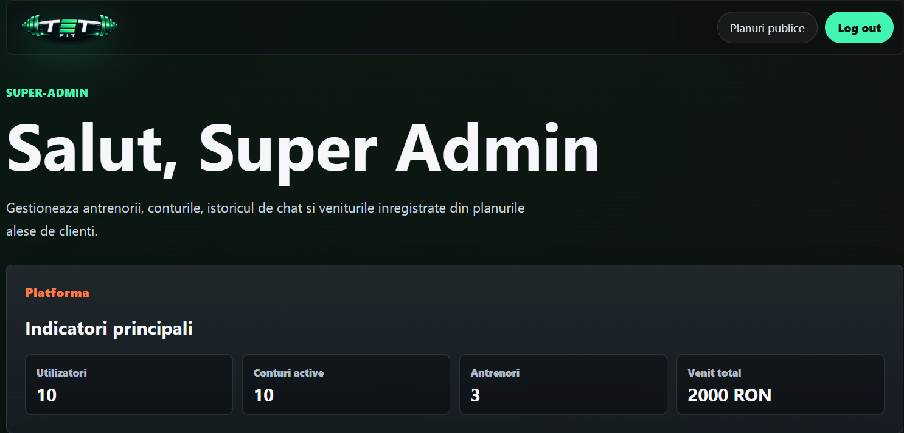
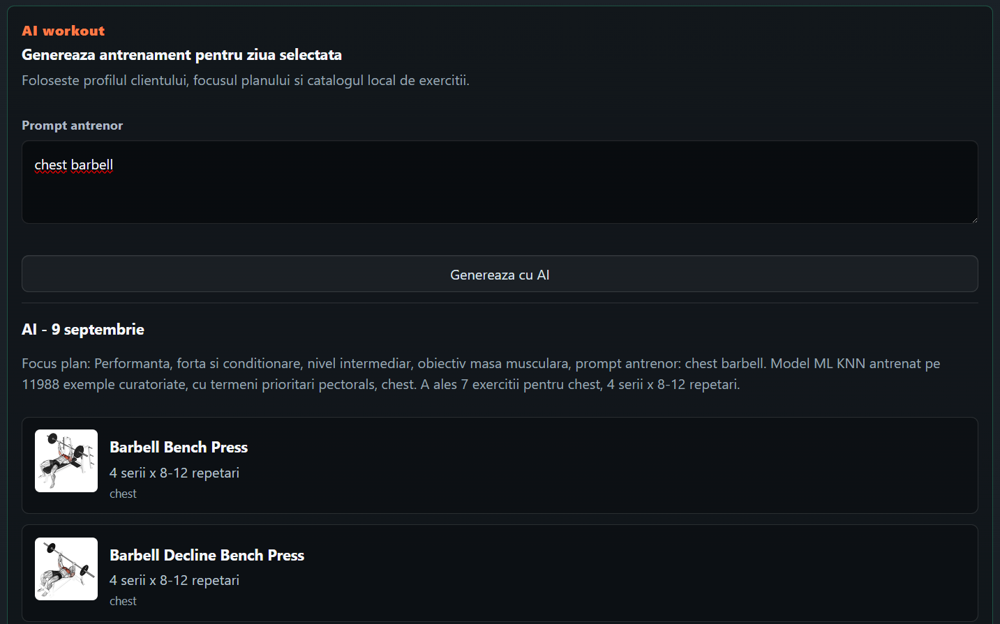
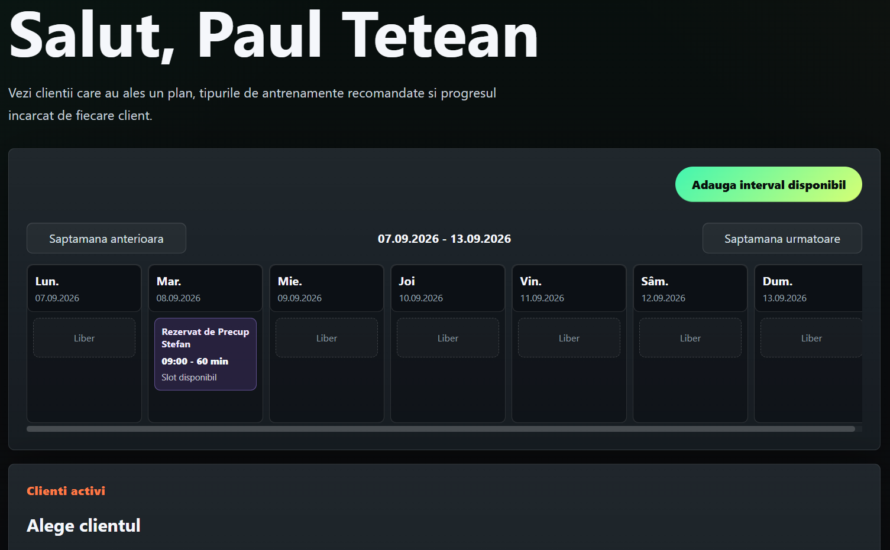
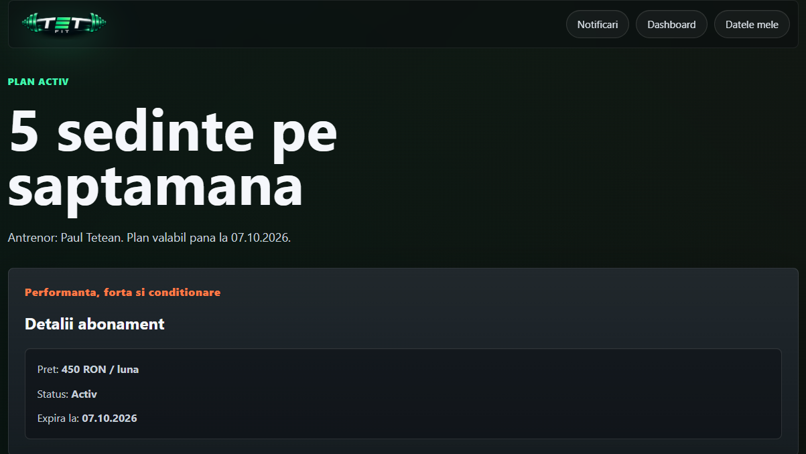
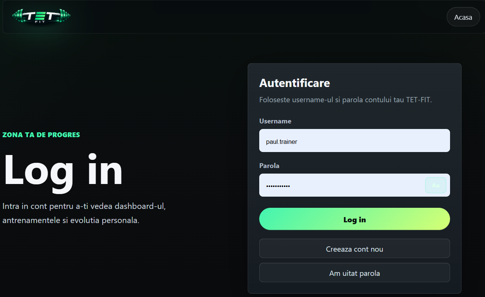

# Portofoliu-CV

# TET-FIT | AI-Assisted Fitness Management Platform

**Full-stack web application · Bachelor's thesis project · React · Java / Spring Boot · PostgreSQL · Machine Learning**

TET-FIT is a role-based fitness management platform that connects personal trainers and clients in one application. It brings together workout planning, AI-assisted exercise recommendations, training progress, nutrition tracking, session scheduling, and direct communication. An administrative dashboard supports trainer and account management.

I designed and developed TET-FIT to address a practical problem in personal training: keeping workout plans, progress records, client communication, and scheduling organized in a single system. The project also reflects my experience as a fitness trainer and my interest in applying software engineering to real-world workflows.

## Application preview



| Client dashboard | Trainer dashboard |
| --- | --- |
|  |  |

| AI-assisted workouts | Exercise progress |
| --- | --- |
|  |  |

<details>
<summary>More screenshots</summary>

### Trainer packages


### Exercise management


### Nutrition targets and progress



### Super-admin dashboard

</details>

## Key features

### Client
- Register, sign in, and manage a personal fitness profile and goals.
- Browse trainers and select a training package.
- View an active plan and trainer-assigned exercises.
- Record completed sets, repetitions, and weights.
- Track training performance through charts and exercise-specific metrics.
- Log nutrition and weight-related data and compare intake with trainer-defined targets.
- Book available training sessions and communicate with the trainer through chat.

### Trainer
- Manage clients, workout programs, exercises, and training packages.
- Assign and customize workouts, including sets, repetition ranges, suggested weights, and technical notes.
- Generate AI-assisted workout suggestions and review or modify them before use.
- Analyze client performance and nutrition progress.
- Configure appointment availability and manage bookings.
- Set nutrition targets and communicate directly with clients.

### Super-administrator
- Create and manage trainer accounts and public packages.
- View platform-level user, trainer, account, and revenue indicators.
- Manage user account status and inspect client–trainer conversation history for administrative oversight.

## AI-assisted workout generation

TET-FIT integrates a **locally trained K-Nearest Neighbors (KNN) machine-learning model** into its workout recommendation workflow. The system considers client profile information, training objectives, the plan's focus, trainer prompts, and a local exercise catalog to propose relevant exercises.

The trainer remains in control: generated suggestions can be reviewed and adjusted before exercises are assigned. The model is a recommendation component, **not a generative large language model**.

## Technology stack

| Layer | Technologies and concepts |
| --- | --- |
| Frontend | React, JavaScript, HTML, CSS, responsive UI, interactive dashboards |
| Backend | Java, Spring Boot, RESTful API development, application business logic |
| Database | PostgreSQL, relational data modeling, persistence |
| Security | Authentication, authorization, role-based access control (Client / Trainer / Super-admin) |
| Machine learning | KNN, model training and integration, exercise recommendation logic |
| Integrations | ExerciseDB, email service integration |
| Engineering | Full-stack integration, API design, debugging, data visualization, modular application design |

## High-level architecture

```text
                 React frontend
                       |
                  REST API calls
                       |
              Spring Boot backend
               (auth-service core)
                  /     |      \
                 /      |       \
          PostgreSQL  Local KNN  External services
           database    model     (ExerciseDB / email)
```

The backend implementation is primarily centered in the Spring Boot **auth-service**; it should not be interpreted as a fully deployed microservices architecture.

## Technical skills demonstrated

- **Full-stack development:** connecting a React user interface to a Java/Spring Boot backend.
- **Backend and API engineering:** implementing application workflows, role-specific endpoints, and REST-based client/server communication.
- **Relational database design:** modeling users, trainer profiles, packages, active client plans, assigned exercises, and progress records in PostgreSQL.
- **Access control:** building separate workflows and permissions for clients, trainers, and super-administrators.
- **Applied machine learning:** integrating a KNN-based recommendation model into a trainer-reviewed workflow.
- **Data visualization:** turning workout and nutrition records into interpretable progress charts and performance indicators.
- **Product thinking:** translating real personal-training requirements into usable features and interfaces.

## Development roadmap

The following are **planned enhancements**, not completed functionality:

- Integrate real online payments and transaction history.
- Add automated workout, booking, message, and subscription-expiration notifications.
- Develop dedicated mobile applications.
- Expand the recommendation system with more advanced algorithms.
- Export client progress reports as PDFs.
- Integrate wearable devices and third-party fitness platforms.
- Improve administrative action logging, confirmation flows, and end-to-end testing.

## Project context

TET-FIT was developed as my **bachelor's degree project in Computer Engineering**. It combines software architecture, database design, frontend/backend development, and applied machine learning with my practical experience in fitness coaching.

**Developer:** Paul Tetean  
**Project:** TET-FIT — AI-Assisted Fitness Management Platform

---

> **Portfolio note:** This repository showcases the application and its engineering concepts. Screenshots illustrate development/demo data; displayed names, figures, and account information should not be treated as live production records.
